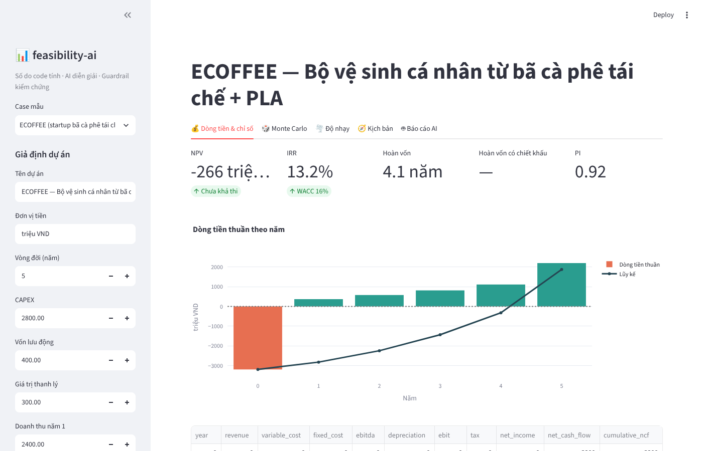
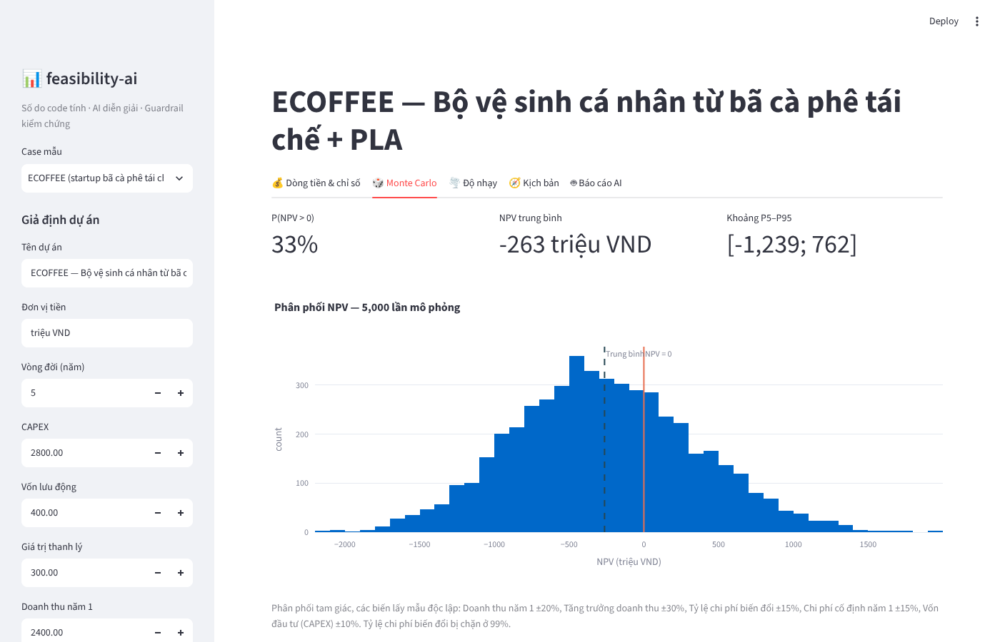
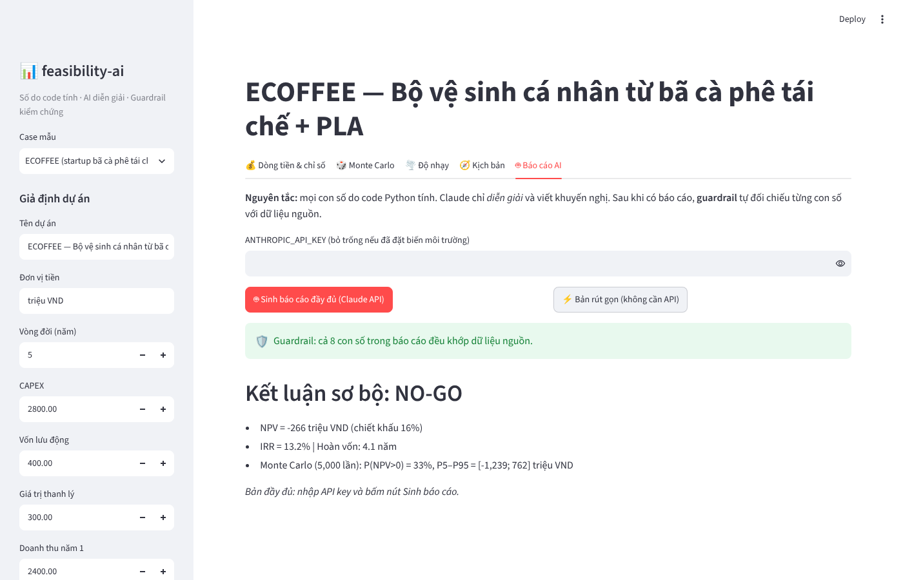

# feasibility-ai — AI thẩm định dự án đầu tư

> **Code tính số · AI diễn giải · Guardrail kiểm chứng.** Công cụ thẩm định dự án
> đầu tư (investment feasibility): tính NPV/IRR, lượng hóa rủi ro bằng Monte Carlo,
> rồi để Claude viết báo cáo, kèm guardrail tự đối chiếu mọi con số AI viết ra.


## Bài toán

Nhập bộ giả định của một dự án (CAPEX, vốn lưu động, doanh thu và tăng trưởng,
chi phí, thuế, WACC) → công cụ tính **các chỉ số hiệu quả tài chính** →
**lượng hóa rủi ro** → AI viết **báo cáo thẩm định + khuyến nghị Go/No-Go**.

Case kèm sẵn: **ECOFFEE**, startup sản xuất bộ vệ sinh cá nhân từ bã cà phê tái chế
và nhựa sinh học PLA, đón đầu lệnh cấm nhựa dùng một lần tại Hà Nội 2026.

## Kết quả case ECOFFEE

| Chỉ số | Giá trị |
|---|---|
| NPV (WACC 16%) | **−266,2 triệu VND** |
| IRR | 13,2% (< WACC) |
| Hoàn vốn giản đơn | 4,1 năm |
| P(NPV > 0), 5.000 lần Monte Carlo | **≈ 33%** |
| Biến nhạy nhất (tornado) | Tỷ lệ chi phí biến đổi |
| **Kết luận** | **NO-GO** ở giả định hiện tại; đòn bẩy chính là giảm chi phí biến đổi |

Các con số này được khóa bằng test (`test_engine.py`), chạy lại là ra đúng.




## Tính năng

- **Chỉ số thẩm định:** NPV, IRR (tự cài bằng bisection), thời gian hoàn vốn có
  nội suy, hoàn vốn có chiết khấu, chỉ số sinh lời (PI)
- **Monte Carlo:** 1.000–10.000 kịch bản, phân phối tam giác trên 5 biến rủi ro,
  tính P(NPV > 0) và khoảng P5–P95
- **Tornado:** độ nhạy one-at-a-time ±20%, xếp hạng biến rủi ro
- **Kịch bản:** xấu / cơ sở / tốt
- **Báo cáo AI (Claude API):** báo cáo thẩm định 5 phần bằng tiếng Việt
- **Guardrail:** đối chiếu mọi con số trong báo cáo AI với dữ liệu nguồn

## Kiến trúc

```
┌──────────────────────────┐  JSON  ┌───────────────────────┐ báo cáo ┌──────────────────────────┐
│ engine.py (Python)       │ ─────▶ │ Claude API            │ ──────▶ │ Guardrail                │
│ NPV · IRR · Monte Carlo  │        │ chỉ diễn giải, không  │         │ check_report_numbers():  │
│ tornado · kịch bản       │        │ tự tính số mới        │         │ số nào không có trong    │
└──────────────────────────┘        └───────────────────────┘         │ JSON → cảnh báo          │
                                                                      └──────────────────────────┘
```

AI không tự tính số. Mọi con số trong báo cáo phải truy được về JSON do code tạo ra;
số nào không khớp (kể cả số AI tự suy ra) được liệt kê để người đọc kiểm tra.



## Cài đặt & chạy

```bash
pip install -r requirements.txt
streamlit run app.py      # mở app
pytest -q                 # chạy test
```

Tab **🤖 Báo cáo AI** cần API key của Anthropic (nhập trong app hoặc đặt biến môi
trường `ANTHROPIC_API_KEY`). Không có key vẫn dùng được 4 tab còn lại và nút
"Bản rút gọn".

## Cấu trúc repo

```
├── app.py            # giao diện Streamlit + gọi Claude API
├── engine.py         # toàn bộ phần tính số + guardrail (hàm thuần, test được)
├── test_engine.py    # test: công thức tính tay, case ECOFFEE, guardrail
├── docs/img/         # ảnh chụp app
├── requirements.txt
└── .gitignore
```

## Giới hạn của mô hình

- Mô hình **tiền khả thi**: khấu hao đường thẳng; năm lỗ thuế bằng 0, **không chuyển lỗ**
  sang năm sau; giá trị thanh lý chưa tính thuế.
- Monte Carlo lấy mẫu 5 biến **độc lập**, chưa mô hình tương quan (ví dụ doanh thu và
  chi phí biến đổi thường đi cùng nhau).
- IRR bằng bisection trả về một nghiệm; dòng tiền đổi dấu nhiều lần có thể có nhiều IRR.
- Guardrail kiểm **con số**, không kiểm **lập luận**: báo cáo vẫn cần người đọc lại.

## Disclaimer

Dự án phục vụ mục đích học tập. Không phải tư vấn đầu tư.
